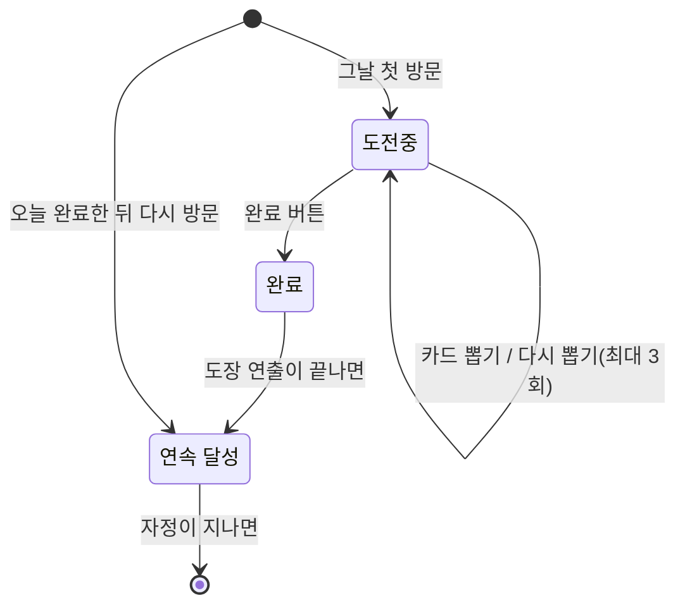

# 밍기적 챌린지 기획서

> 원본: Claude 아티팩트 (탭 2개: 기획서, 미션 데이터) (2026-10-15에 마크다운으로 내보냄)

2026-09-28 · @유진

## 개요

"밍기적 챌린지"는 하루 1개, 부담 없는 미션을 무작위로 받아 수행하고 그 기록이 그림일기처럼 쌓이는 습관형 토이 웹앱이다. 완료 인증은 사진이나 증빙 없이 자기신고(체크) 방식만 사용해 진입장벽을 최소화하고, 완료 시의 도장 연출과 쌓여가는 기록으로 재미와 성취감을 만든다. 이름은 '내가 일으킬 수 있는 아주 작은 기적, 밍기적'이라는 인터넷 밈에서 따왔다.

- 재미 요소: 랜덤 뽑기, 스와이프 재뽑기, 랜덤 도장 연출
- 사용성: 하루 1분 안쪽으로 끝나는 가벼운 루틴
- 플랫폼: 모바일 우선 반응형 웹앱(데스크톱도 지원), 무료 플랜 범위 안에서 운영
- 문서 기준: 디자인 기준값, 도장, 마스코트 포즈는 '밍기적 챌린지 화면 설계'에 맞춰 확정했다. 남은 결정은 문서 끝 '남은 결정 사항'에 모아 둔다.

## 핵심 결정 요약

| 항목 | 결정 내용 |
|---|---|
| 미션 풀 | 총 200개: 쉬움 180개(6개 분류 × 30) + 도전적 20개(10%). 전체 목록은 '미션 데이터' 탭 |
| 하루 흐름 | 한국 시간 기준 하루 1개 완료(00:00대에 도착한 요청은 전날로 처리). 첫 카드 + 재뽑기 최대 3회 = 하루 최대 4장 |
| 재뽑기 UI | 카드 스와이프(Pointer Events) + '다시 뽑기' 버튼 병행(데스크톱은 버튼만), 남은 재뽑기는 점 3개로 표시 |
| 반복 방지 | 완료한 미션은 180일, 넘긴 미션은 14일 동안 제외. 후보가 없으면 가장 오래전에 본 미션부터 |
| 완료 체크 | 자기신고. 누르면 도장 6종(문구·그림·잉크색이 짝지어진 디자인) 중 하나가 랜덤으로 찍힘. 완료 취소는 없음 |
| 미완료 | 기록에 남기지 않음, 실패 상태 없음 |
| 기록 | 그림일기식 월간 캘린더(완료한 날에 도장) + 누적 완료 수 |
| 화면 탭 | 홈 / 기록 2개. 앱 정보는 기록 화면 맨 아래. 설정 탭은 4단계(보류)와 함께 미룸 |
| 미션 제출 | 4단계(보류). 만들게 되면 사용자가 제출하고 운영자가 승인해 풀에 넣는다. 개발하지 않을 수도 있다 |
| 저장·사용자 구분 | Supabase + 익명 로그인(로그인 화면 없음) |
| 프론트엔드 | Next.js(App Router) + TypeScript |
| 비주얼 | 크레파스·색연필 손그림 + 그림일기 프레임, 마스코트는 티라노 |

## 화면 구성 (IA)

하단 탭 2개(홈 / 기록)로 시작한다. 데스크톱에서는 같은 2개를 상단 헤더 내비게이션으로 보여준다. 앱 정보(버전, 만든 사람)는 기록 화면 맨 아래에 작게 둔다. 설정 탭과 관리자 페이지는 4단계(보류)이고, 만들지 않을 수도 있다.

| 경로 | 화면 | 들어가는 내용 |
|---|---|---|
| / | 홈 | 오늘의 도전 카드, 재뽑기, 완료 버튼, 최근 기록 3개 |
| /records | 기록 | 월간 캘린더, 누적·연속 수, 날짜별 상세, 앱 정보(맨 아래) |
| /settings | 설정 | (4단계·보류) 미션 제출, 내가 제출한 미션 |
| /admin | 관리자(4단계·보류, 탭 없음) | 제출 미션 승인·반려 |

## 화면별 상세 동작

### 홈

홈은 하루 동안 도전중 → 완료 → 연속 달성 세 상태를 거친다. 그날 처음 들어오면 뒤집힌 카드 더미가 보이고, 사용자가 누르거나 넘겨서 첫 카드를 직접 뽑는다. 첫 뽑기는 재뽑기 횟수에 세지 않는다.

- 카드 뒤에 다음 카드가 살짝 겹쳐 보이는 스택 형태. 카드 너비의 약 30% 이상 끌면 날아가고, 못 미치면 제자리로 돌아온다.
- '다시 뽑기' 버튼은 항상 보인다. 남은 재뽑기가 0회면 스와이프와 버튼이 모두 막히고 완료 버튼만 남는다.
- 넘긴 카드로 되돌아갈 수는 없다.
- 새로고침하거나 나중에 다시 들어와도 보고 있던 카드와 남은 재뽑기 횟수는 그대로다(서버에 저장). 오늘 이미 완료했다면 바로 연속 달성 화면을 보여준다.
- 도전적 티어 미션은 카드에 작은 '도전' 배지를 붙인다.
- 완료를 누르면 도장이 위에서 내려와 쾅 찍히고(약 0.6초), 마스코트 '완료' 포즈와 칭찬 문구가 나온다. 연출이 끝나면 연속 달성 화면으로 넘어간다. 연속 달성 화면은 이번 달 달력에 완료한 날마다 도장을 찍어 보여주고, 위에 "N일 연속 달성!"과 오늘 미션 한 줄을, 아래에 "내일 또 만나요" 문구를 넣는다.
- 카드 아래에 최근 기록 3개(날짜, 미션, 도장)와 '전체 보기'(→ 기록 탭)를 둔다. 기록이 하나도 없으면 최근 기록 영역 자체를 숨긴다. 1~2개면 3칸 배치는 그대로 두고 앞에서부터 1~2칸만 채운다.
- 화면을 켜둔 채 자정이 지나면, 다시 화면에 돌아오거나 버튼을 누를 때 날짜를 확인해 새 카드로 바꾼다.
- 처음 쓰는 사람에게는 온보딩 없이 바로 카드 더미를 보여준다. 모바일은 버튼 아래에 "스와이프 해서 새로운 미션 뽑기" 힌트를 뽑기 전과 뽑은 뒤 모두 항상 띄운다. 데스크톱 힌트는 아래 '데스크톱'에 있다.

### 기록

- 일~토 월간 캘린더. 좌우 화살표로 월 이동, 처음 쓴 달 이전과 이번 달 이후로는 이동하지 않는다.
- 완료한 날은 그날 찍힌 도장을 작게, 나머지 날은 빈 칸, 오늘은 테두리로 강조한다.
- 완료한 날짜를 누르면 상세 카드(날짜, 미션 문구, 도장, 완료 시각)가 아래에 나타난다.
- 캘린더 위에 누적 완료 수와 연속 일수를 칩으로 보여준다(예: '누적 18개', '5일 연속').
- 연속 일수 규칙: 오늘 아직 완료하지 않았으면 어제까지의 연속 일수를 그대로 보여주고, 오늘 완료하면 1을 더한다. 하루라도 완료하지 않고 지나가면 0부터 다시 세고, 따로 실패 표시는 하지 않는다.
- 목록 보기와 필터 탭은 1단계에서 뺀다.
- 화면 맨 아래에 앱 정보(버전, 만든 사람)를 작게 둔다. 설정 탭이 없어서 여기로 옮겼다.

### 데스크톱

화면이 넓은 기기에서는 모바일과 같은 기능을 2단으로 보여준다. 기준은 화면 설계의 데스크톱 보드 4개(1280px)다.

- 하단 탭 대신 상단 헤더에 앱 이름·날짜와 홈 / 기록 메뉴를 두고, 지금 메뉴는 초록 밑줄로 표시한다.
- 본문은 최대 1040px다. 홈은 왼쪽에 카드 영역(440px), 오른쪽에 이번 달 달력과 누적·연속 칩, 최근 기록 3개(536px)를 둔다.
- 재뽑기는 '다시 뽑기' 버튼으로만 한다(스와이프 없음). 뽑기 전에는 '카드 뽑기' 옆에 '다시 뽑기'가 비활성으로 보인다.
- 힌트: 뽑기 전 "카드를 뽑은 뒤 마음에 안 들면 '다시 뽑기'로 바꿀 수 있어요", 뽑은 뒤 "마음에 안 들면 '다시 뽑기'를 눌러 바꿀 수 있어요".
- 완료해도 별도의 연속 달성 화면으로 넘어가지 않는다. 왼쪽 카드에 도장이 찍히고 완료 포즈와 "N일 연속 달성!"이 나오며, 오른쪽 달력에도 오늘 도장이 찍힌다.
- 기록은 왼쪽에 큰 달력, 오른쪽에 날짜 상세 카드를 둔다. 앱 정보는 모바일처럼 맨 아래에 둔다.

### 설정 (4단계·보류)

설정 탭과 아래 관리자 화면은 4단계로 미뤘고, 만들지 않을 수도 있다. 만들게 되면 하단 탭에 설정을 다시 넣는다.

- 미션 제출: 미션 문구(5~40자)와 난이도(쉬움/도전적)를 입력한다. 제출하면 "검토 후 반영돼요" 알림을 띄운다.
- 한 사람은 하루 3개까지 제출할 수 있고, 같은 문구는 다시 낼 수 없다.
- 내가 제출한 미션: 문구와 상태(대기/승인/반려)를 보여준다.

### 관리자 (/admin, 4단계·보류)

- 대기 중인 제출 목록에서 승인 또는 반려한다. 문구를 고친 뒤 승인할 수 있다.
- 승인하면 missions에 새 행(예: S0001)이 생기고 다음 뽑기부터 후보가 된다.
- 관리자 이메일 계정 1개로만 들어갈 수 있다. 익명 사용자가 접근하면 로그인 화면이 나오고, 승인 권한은 DB 접근 규칙(RLS)으로도 막는다.

### 공통 상태

| 상황 | 화면 |
|---|---|
| 불러오는 중 | 마스코트 '음료 마시기' + "미션 꺼내는 중…" |
| 오류(네트워크 등) | 마스코트 '고민 중' + 다시 시도 버튼 |
| 기록 없음 | 마스코트 '도전 중' + "첫 도장을 찍어보세요" |

## 미션 시스템 상세

### 하루의 기준

하루는 한국 시간(Asia/Seoul) 기준이고, 날짜는 서버가 요청 도착 시각으로 판단한다. 00:00:00~00:00:59에 도착한 요청은 전날 요청으로, 00:01:00부터는 새 날 요청으로 처리한다(자정 1분 유예). 그래서 자정 직전에 누른 완료는 00:00대에 도착해도 전날 미션으로 인정된다.

구현은 '도착 시각 − 1분'을 한국 시간 날짜로 바꾸는 함수 하나로 통일한다. 뽑기·재뽑기·완료·연속 달성 계산이 모두 이 함수를 쓴다.

### 뽑기 규칙

1. 후보 = 사용 중인 미션 전체 − 제외 목록
2. 제외 목록 = 최근 180일 안에 완료한 미션 + 최근 14일 안에 넘긴 미션 + 오늘 이미 본 미션
3. 후보에서 균등하게 하나를 뽑는다. 도전적 티어는 풀의 10%라 자연스럽게 약 10% 확률로 나온다.
4. 후보가 비면 오늘 본 미션만 빼고, 마지막으로 본 날이 가장 오래된 미션부터 고른다.

180일과 14일은 상수로 두고 운영하며 조정한다. 매일 재뽑기를 다 쓰는 사람도 약 5개월, 재뽑기를 안 쓰는 사람은 약 6개월 동안 완료한 미션을 다시 만나지 않는다. 뽑기와 재뽑기 횟수 검사는 클라이언트가 우회하지 못하도록 서버에서 처리한다.

### 재뽑기

완료 전까지 하루 최대 3회(첫 카드 포함 4장)다. 남은 횟수는 점 3개로 표시하고, 마지막 카드에서는 완료만 가능하다.

### 완료 체크

완료 버튼을 누르면 서버가 도장 6종(p01~p06) 중 하나를 균등하게 랜덤으로 골라 완료 시각과 함께 기록한다. 도장 목록은 '에셋 목록'의 도장 6종 표에 있다. 완료 취소는 없다. 그날 끝내지 못한 미션은 실패 처리 없이 기록에 남기지 않는다.

### 미션 구성

전체 목록과 ID는 '미션 데이터' 탭에 있다. 분류는 콘텐츠 관리용이며 화면에 보이지 않는다.

| 분류 | ID | 개수 |
|---|---|---|
| 몸/행동 | E001–E030 | 30 |
| 환경 상호작용 | E031–E060 | 30 |
| 인지/생각 | E061–E090 | 30 |
| 감정/자기표현 | E091–E120 | 30 |
| 이상한 행동/밈 | E121–E150 | 30 |
| 디지털/습관 | E151–E180 | 30 |
| 도전적 | C01–C20 | 20 |
| 합계 |  | 200 |

### 미션 작성 기준

새 미션을 추가할 때 쓴다(4단계를 만들면 제출 미션 승인에도 쓴다). 글자 수 제한은 두지 않는다.

- 혼자, 도구 없이, 1분 안쪽에 끝난다(도전적 티어 제외).
- 끝난 순간이 분명하다. "~안 하기"는 "5분 동안"처럼 시간을 붙인다.
- 기존 미션과 동작·대상이 겹치지 않는다.
- 남에게 거짓말하거나 불편을 주는 미션은 넣지 않는다.

관리자 화면이 없는 동안 미션 추가와 정리는 Supabase 대시보드(Table Editor 또는 SQL Editor)에서 직접 한다. 쓰지 않을 미션은 지우지 않고 is_active를 false로 바꾼다. 지난 기록(daily_entries)이 그 미션 ID를 가리키고 있어서다.

## 데이터 모델과 저장

모든 데이터는 Supabase(Postgres) 한 곳에 둔다. 앱을 처음 열면 `signInAnonymously()`로 익명 계정을 만들고, 기록은 그 계정의 `auth.uid()`에 묶는다. 로그인 화면은 없다.

### missions

| 컬럼 | 타입 | 설명 |
|---|---|---|
| id | text, PK | E001–E180, C01–C20(4단계를 만들면 승인된 제출은 S0001부터) |
| text | text | 미션 문구 |
| difficulty | text | easy / challenge |
| category | text, null 허용 | 내부 분류. 제출분은 비워둠 |
| source | text | seed / user |
| is_active | boolean | false면 뽑기에서 빠짐 |
| created_at | timestamptz |  |

### daily_entries (사용자당 하루 1행)

| 컬럼 | 타입 | 설명 |
|---|---|---|
| user_id | uuid | auth.uid() |
| date | date | 한국 시간 기준 날짜. (user_id, date)는 유일 |
| current_mission_id | text | 지금 보고 있는, 또는 완료한 미션 |
| seen_mission_ids | text[] | 그날 본 미션 전부(첫 카드 + 재뽑기) |
| reroll_count | int | 0~3 |
| completed_at | timestamptz, null 허용 | null이면 미완료 |
| stamp_id | text, null 허용 | 찍힌 도장 ID(p01~p06) |

반복 방지는 이 테이블에서 계산한다. 완료한 미션은 completed_at이 있는 행의 current_mission_id, 넘긴 미션은 seen_mission_ids에서 완료한 것을 뺀 나머지다.

### submissions (4단계·보류)

| 컬럼 | 타입 | 설명 |
|---|---|---|
| id | uuid, PK |  |
| user_id | uuid | 제출한 사람 |
| text | text | 5~40자 |
| difficulty | text | easy / challenge |
| status | text | pending / approved / rejected |
| mission_id | text, null 허용 | 승인 후 생긴 missions.id |
| created_at, reviewed_at | timestamptz |  |

### 접근 규칙(RLS)

- missions: 누구나 is_active인 행을 읽을 수 있다. 앱에는 쓰기 기능이 없고, 운영자가 Supabase 대시보드에서 직접 고친다.
- daily_entries: 본인 행만 읽는다. 쓰기는 뽑기·완료 서버 코드를 통해서만 한다.
- (4단계) submissions: 본인 행을 읽고 만들 수 있고, 상태 변경은 관리자만 한다.
- (4단계) 관리자는 관리자 이메일 계정의 user id로 판별한다(예: admins 테이블 또는 서버 환경변수).

### 알고 가는 제약

익명 계정은 브라우저 데이터를 지우거나 기기를 바꾸면 기록을 다시 찾을 수 없다. 나중에 이메일이나 소셜 로그인을 연결하면 같은 계정을 이어서 쓸 수 있지만, 1단계 범위가 아니다. 미션 200개는 '미션 데이터' 탭을 그대로 시드(SQL 또는 JSON)로 옮긴다.

## 비주얼 컨셉

전체 톤은 크레파스·색연필 손그림과 초등학생 그림일기다. 아래 참고 이미지마다 어떤 부분을 참고하는지 적어두었다. 이미지와 이 문서의 결정이 다르면 문서를 따른다.

### 디자인 기준값

| 항목 | 값 |
|---|---|
| 배경 | #FFFFFF 위에 옅은 도화지 텍스처(반복 이미지, 320px 타일). 화면 배경과 하단 탭에만 쓴다. 거친 텍스처는 회색으로 보여서 쓰지 않는다 |
| 카드 | 무늬 없는 #FFFFFF. 회색 손그림 테두리 #6B6B6B(크레파스 질감)로 배경과 구분한다 |
| 글자 | 본문 #3A3A3A, 보조 글자 #6B6B6B, 입력란·보조 테두리 #9A9A9A |
| 주요 색 | 초록 #4F7A4C(티라노 색). 주요 버튼, 선택된 탭, 오늘 날짜 테두리, 연속 일수 강조 |
| 도장 잉크 | 도장마다 한 색. '에셋 목록'의 도장 6종 표 참고 |
| 포인트 색 | 크레파스 파스텔: 주황 #F4A259(남은 재뽑기 점), 노랑 #F6C85F(카드 위 테이프), 초록 #8CC084, 하늘 #7FB7E6, 보라 #B39DDB |
| 요일·칩 | 일요일 #C44A5A, 토요일 #3F6FA8, '오늘의 미션' 칩 #FFF2D1, 연속 칩 #E4F1DF(글자 #2F5E2C), '도전' 배지 #FBE3E6(글자 #8A3340) |
| 폰트 | 제목·미션 문구·버튼·도장 문구는 손글씨체 Gaegu, 본문·작은 글씨는 Noto Sans KR |
| 레이아웃 | 모바일 우선. 콘텐츠 최대 너비 480px 가운데 정렬, 미션 카드 최대 400px, 하단 탭 2개(홈/기록) 고정. 데스크톱은 상단 헤더 내비게이션 + 최대 1040px 2단(화면 설계의 데스크톱 보드) |
| 테두리·구분선 | CSS 직선 대신 SVG 손그림 선 |
| 다크 모드 | 지원하지 않음(그림일기 톤 유지) |
| 움직임 | 도장은 위에서 내려와 쾅 찍힌다(약 0.6초). 카드는 스와이프 방향으로 기울며 날아감. '동작 줄이기' 설정이 켜져 있으면 페이드만 쓴다 |

### 화면·도장 구성 참고

[이미지: 학교/어린이집 스타일 도장 콜렉션 참고 이미지]

위 이미지는 도장의 구성(원형 테두리 + 문구 + 캐릭터)만 참고한다. 이 화면처럼 사용자가 도장을 고르지는 않는다(자동 랜덤).

[이미지: UI 흐름 참고 1]

[이미지: UI 흐름 참고 2]

위 두 이미지는 홈(오늘의 카드 + 최근 기록), 완료 연출, 기록 캘린더의 배치와 정보량을 참고한다. 이미지에 있는 실패·진행중 탭, 길게 눌러 완료하는 버튼, 기록 목록 필터는 이 기획에 없다.

### 메인 캐릭터 후보 (AI 생성 참고 이미지)

[이미지: 메인 캐릭터 후보: 물범과 티라노 포즈 시트]

두 후보(물범/티라노)는 AI 이미지 생성으로 만든 참고 시트다. 시트의 포즈 중 이 앱에서는 기본 상태 / 신남 / 고민 중(시트의 '멍 때리기') / 완료 / 도전 중 / 음료 마시기(시트의 '좋아하는 것') 6가지만 쓴다. '쉬는 중' 포즈는 쓰지 않는다. 못 한 날을 실패로 기록하지 않으므로 '실패' 포즈는 쓰지 않는다. 최종 캐릭터는 티라노로 정했다.

### 도장/스티커 아트 스타일 참고

크레파스·색연필로 쓱쓱 그린 듯한 러프한 손맛이 핵심이다. 매끈한 벡터 선 대신 두께가 고르지 않은 삐뚤빼뚤한 선으로, 도형 하나에 크레파스 색 하나를 쓴다. 대부분 선만 그리고, 사과처럼 일부만 성기게 칠하는 것은 괜찮다.

[이미지: 도장 스타일 참고 - 손그림 고양이]

[이미지: 도장/스티커 스타일 참고 - 컴러풀 낙서 모음]

[이미지: 도장 스타일 참고 - 참 잘했어요 도장]

[이미지: 도장 스타일 참고 - 작은 도형 모음]

[이미지: 도장 스타일 참고 - 토끼와 당근]

[이미지: 도장 스타일 참고 - 오리·악어·벌 낙서]

[이미지: 도장 스타일 참고 - 사과]

도장은 "참 잘했어요" 도장처럼 원형 테두리 안에 손글씨 문구와 동물·사물 그림을 넣는 구성을 기본 틀로 삼는다. 앞의 학교 도장 이미지가 구성을 정한다면, 이 참고들은 실제로 쓸 선과 색의 질감을 정한다.

### 전체 UI 프레임 스타일 참고

앱 전체의 카드/화면 프레임도 그림일기장 같은 손그림 톤을 따른다.

[이미지: UI 프레임 스타일 참고 - 그림일기 페이지]

핵심 요소: 옅은 도화지 텍스처의 화이트 배경과 무늬 없는 흰 카드, 손으로 그린 듯 살짝 울퉁불퉁한 회색 웨이브된 테두리(각진 사각형 대신), 구획을 나누는 얇은 크레용 터치 구분선(날짜/제목/본문처럼 구역 구분), 코너에 작게 들어가는 캐릭터·하트 같은 낙서 장식. 컬러는 포인트로만 쓰고 전체 톤은 화이트 배경으로 차분하게 유지한다.

이 프레임 컨셉은 홈 화면의 오늘의 도전 카드, 기록 페이지의 캘린더/상세 카드 등 앱 전반의 카드 컴포넌트에 공통 적용한다.

## 에셋 목록

에셋은 화면 설계에 대부분 준비되어 있어 처음부터 실제 에셋으로 개발한다. 마스코트 포즈는 참고 시트에서 잘라 배경을 지운 이미지가 화면 설계에 있고, 도장은 화면 설계의 SVG 도장을 코드로 옮긴다.

| 에셋 | 수량 | 형식 | 쓰는 곳 |
|---|---|---|---|
| 마스코트 포즈 | 6종(기본/신남/고민 중/완료/도전 중/음료 마시기) | 투명 PNG. 화면 설계의 이미지를 쓰고, 해상도가 낮은 것은 2배 크기로 다시 만든다 | 홈, 완료 연출, 연속 달성, 로딩·오류·빈 상태 |
| 도장 | 6종(p01~p06) + 달력용 작은 도장 | SVG 컴포넌트(화면 설계의 '도장 컴포넌트') | 완료 연출, 연속 달성·기록 달력, 최근 기록, 기록 상세 |
| 도화지 텍스처 | 1 | 반복 PNG(320px 타일, 화면 설계에 있음) | 화면 배경, 하단 탭 |
| 카드 테두리 | 1~2종 | SVG(크기가 바뀌어도 깨지지 않게) | 모든 카드 |
| 구분선 | 2~3종 | SVG | 카드 안 구역 나누기 |
| 낙서 장식 | 하트·별·반짝이 등 5~8개 | SVG | 카드 모서리, 완료 연출 |
| 하단 탭 아이콘 | 2개(홈/기록) | 손그림 SVG | 하단 탭 |
| 파비콘·공유 이미지 | 1세트 | PNG | 브라우저 탭, 링크 미리보기 |

도장은 문구·그림·잉크색이 짝지어진 6종이고, 완료할 때 이 중 하나를 랜덤으로 찍는다. 디자인 원본은 화면 설계의 '도장 6종' 보드와 '도장 컴포넌트'다. stamp_id에는 도장 ID(p01~p06)를 그대로 저장한다.

| ID | 문구 | 그림 | 잉크 | 문구 배치 |
|---|---|---|---|---|
| p01 | 참 잘했어요 | 고양이 | #E0626F | 위쪽 반원 |
| p02 | 내가 해냄 | 거들먹거리는 강아지 | #4A82D8 | 위쪽 반원 |
| p03 | VERY GOOD | 엄지 | #E0626F | 위쪽 반원 |
| p04 | 럭키잖아 | 토끼 | #5A9E4F | 아래쪽 한 줄 |
| p05 | 최고야 | 별 | #EE6FA6 | 아래쪽 한 줄 |
| p06 | 야르~ | 휘파람 부는 오리(음표 2개) | #F2B600 | 아래쪽 한 줄 |

코드에서도 화면 설계와 같은 도장 컴포넌트 하나(variant, size, mini)로 만든다. 원본은 지름 190px 기준이고 다른 크기는 통째로 확대·축소한다. 달력과 최근 기록의 작은 도장(mini)은 문구 없이 원형 틀과 그림만 도장 색으로 보여준다.

## 기술 스택

| 영역 | 선택 | 상태 |
|---|---|---|
| 프레임워크 | Next.js(App Router) + TypeScript | 결정 |
| DB·인증 | Supabase(Postgres, 익명 로그인, RLS) | 결정 |
| Supabase 연결 | @supabase/ssr. 뽑기·재뽑기·완료는 Route Handler에서 Supabase 함수(RPC)를 불러 처리. 자세한 내용은 '밍기적 챌린지 서버 설계' 문서 | 결정 |
| 스타일 | Tailwind CSS | 결정 |
| 애니메이션·제스처 | Motion(구 framer-motion): 카드 드래그, 도장 연출 | 결정 |
| 날짜 | date-fns + @date-fns/tz(Asia/Seoul) | 결정 |
| 폰트 | next/font/google로 Gaegu(손글씨)와 Noto Sans KR(본문) | 결정 |
| 배포 | Vercel 무료 플랜 | 결정 |

별도 상태 관리 라이브러리는 쓰지 않고 시작한다. 화면이 적고 데이터가 대부분 서버에 있기 때문이다. Supabase 무료 프로젝트는 일정 기간 접속이 없으면 일시 중지될 수 있으니 배포 후 확인이 필요하다.

## 개발 단계

화면 설계와 에셋(마스코트 포즈, 도장 6종, 도화지 텍스처)이 준비되어 있으니, 디자인 기반을 먼저 코드로 옮기고 핵심 루프(뽑기 → 완료 → 기록)를 배포한다. 미션 제출·관리자 기능은 4단계(보류)이고 만들지 않을 수도 있다. 항목 끝 괄호는 참고할 화면 설계 보드다.

### 1단계 — 디자인 기반

- Next.js 프로젝트 생성, Tailwind에 디자인 기준값(색·폰트·레이아웃) 등록, next/font로 Gaegu·Noto Sans KR 적용
- 공통 요소: 도화지 텍스처 배경, 손그림 카드 테두리(크레파스 질감 SVG 필터), 버튼, 칩·배지, 하단 탭 2개(홈/기록)와 데스크톱 상단 내비게이션
- 도장 컴포넌트: 도장 6종 + 달력용 작은 도장(도장 6종, 도장 컴포넌트)
- 마스코트 포즈 6종과 도화지 텍스처를 public 폴더에 배치

### 2단계 — 핵심 루프

- Supabase 프로젝트, 테이블 2개(missions, daily_entries), RLS, 익명 로그인 설정, 미션 200개 시드
- 서버: 날짜 판단 함수(자정 1분 유예), 오늘 카드 조회·뽑기·재뽑기·완료(반복 방지 규칙 포함)
- 홈 뽑기 전: 카드 더미, 카드 뽑기 버튼, 남은 재뽑기 점(홈 · 도전중(뽑기 전))
- 홈 도전중: 카드 스택, 스와이프 + 다시 뽑기 버튼, 도전 배지, 스와이프 힌트(홈 · 도전중(카드 확인·재뽑기))
- 완료 연출: 도장이 위에서 내려와 쾅, 완료 포즈(홈 · 완료 연출)
- 연속 달성: 이번 달 달력과 연속 일수(홈 · 연속 달성)
- 최근 기록 3개와 0개·1~2개 상태(홈 · 최근 기록 상태)
- 기록: 월간 캘린더, 날짜 상세, 누적·연속 칩, 맨 아래 앱 정보(기록)
- 불러오는 중·오류·기록 없음(공통 상태)
- 데스크톱 배치: 상단 내비게이션, 2단 홈·기록, 버튼으로만 재뽑기, 완료와 연속 달성을 한 화면에(데스크톱 보드 4개)
- Vercel 배포

### 3단계 — 다듬기

- 스와이프·도장 연출의 속도와 손맛 조정, '동작 줄이기' 대응
- 해상도가 낮은 마스코트 포즈(음료 마시기 등) 고해상도 교체
- 낙서 장식, 파비콘·공유 이미지

### 4단계 — 미션 제출·관리자(보류)

관리자의 역할을 아직 정하지 않아 이 단계는 맨 뒤로 미루고, 경우에 따라 만들지 않는다. 사용자 미션 제출 화면, 관리자 로그인 화면, 익명 세션과 관리자 로그인의 충돌 처리, 제출 미션 검토(승인·반려) 화면이 여기에 들어간다. 1~3단계는 이 기능 없이 완결되고, 그동안 미션 추가·정리는 Supabase 대시보드에서 한다.

- 설정 탭 다시 추가: 제출 폼, 하루 3개 제한, 내 제출 목록(설정 · 미션 제출)
- 관리자 로그인과 /admin 승인·반려(관리자 · 제출 미션 검토)

## 남은 결정 사항

- [x] 마스코트 최종 선택: 물범 vs 티라노 → 티라노로 확정
- [x] 도장 문구와 디자인 확정 → 문구·그림·색이 짝지어진 6종(에셋 목록의 도장 표)
- [x] 앱 이름: '오늘의 작은 도전' 대신 '밍기적 챌린지'로 확정
- [x] 디자인 기준값의 '(제안)' 확인: 색·폰트 → 화면 설계 기준으로 확정
- [ ] '미션 데이터' 탭에서 바뀐 102개 미션 검토
- [x] p04 도장 문구: 화면 설계의 도장에는 '럭키잖아', 보드 설명에는 '완전 럭키잖아' → 도장대로 '럭키잖아'로 확정
- [x] 처음 쓰는 사람용 힌트: 이 문서는 '한 번만', 화면 설계는 두 홈 화면에 항상 표시 → 항상 표시로 확정
- [x] 하단 탭: 홈 / 기록 / 설정 3개 → 홈 / 기록 2개로 확정. 앱 정보는 기록 화면 맨 아래
- [x] 미션 글자 수 제한(40자) → 두지 않음(작성 기준과 DB 모두)
- [x] 관리자 승인 ID 시작 번호 → 4단계와 함께 보류. 만들게 되면 서버 설계대로 S0001부터

---

## [탭 2] 미션 데이터

미션 200개(쉬움 180 + 도전적 20)의 원본 목록이다. ID는 Supabase `missions.id` 시드 값으로 그대로 쓴다.

### 정리 기준과 바뀐 항목

기획서 본문에 있던 목록을 이 탭으로 옮기면서 102개를 고쳤다. 원래 문구는 문서 히스토리에 남아 있다. 정리 기준은 다음과 같다.

- 같은 동작의 변형(예: 폰 내려놓기 / 손에서 폰 내려놓기 / 폰 내려놓은 상태 유지)은 하나만 남기고 나머지는 새 미션으로 바꿈
- 완료 시점이 없는 미션(예: 지금 감정 유지하기, 폰 잡지 않기)은 시간이나 개수 기준을 넣거나 교체
- 새로 넣는 미션은 처음 예시(물 마실 때 이상한 포즈, 영화 주인공처럼 걷기)의 웃긴 톤을 우선
- 도전적 티어는 뽑힌 시각과 상관없이 할 수 있게 바꾸고, 남을 속이는 미션(알아도 모르는 척 길 묻기)은 뺌

| 분류 | 바뀐 ID |
|---|---|
| 몸/행동 | E021, E022, E023, E027 |
| 환경 상호작용 | E038, E043, E045, E048, E049, E051, E053, E055, E056, E059, E060 |
| 인지/생각 | E066, E070, E072, E073, E075–E082, E086, E088, E090 |
| 감정/자기표현 | E096, E099, E101, E106–E108, E110–E120 |
| 이상한 행동/밈 | E126, E135, E137–E150 |
| 디지털/습관 | E152–E155, E157, E158, E160–E180 |
| 도전적 | C03, C07–C15, C18, C19 |

앞으로 추가하는 미션은 기획서의 '미션 작성 기준'을 따른다.

### 몸/행동 (E001–E030)

| ID | 미션 |
|---|---|
| E001 | 한쪽 다리로 5초 서 있기 |
| E002 | 발끝으로 3걸음 걷기 |
| E003 | 어깨를 천천히 5번 돌리기 |
| E004 | 고개를 좌우로 천천히 움직이기 |
| E005 | 손을 머리 위로 쭉 뻗기 |
| E006 | 손등으로 코 살짝 건드리기 |
| E007 | 눈 감고 제자리에서 한 바퀴 돌기 |
| E008 | 손가락으로 공중에 동그라미 그리기 |
| E009 | 의자에서 천천히 일어나기 |
| E010 | 양손으로 박수 5번 치기 |
| E011 | 팔을 앞으로 쭉 뻗고 5초 유지 |
| E012 | 발뒤꿈치로 3걸음 걷기 |
| E013 | 손을 등 뒤로 깍지 끼기 |
| E014 | 양쪽 어깨 번갈아 올리기 |
| E015 | 허리 살짝 숙였다 펴기 |
| E016 | 손목 가볍게 돌리기 |
| E017 | 양손으로 얼굴 가볍게 감싸기 |
| E018 | 입 크게 벌렸다 닫기 |
| E019 | 눈 크게 떴다가 천천히 감기 |
| E020 | 발을 바닥에 톡톡 5번 두드리기 |
| E021 | 물 마실 때 이상한 포즈로 마시기 |
| E022 | 등을 벽에 붙이고 10초 서 있기 |
| E023 | 제자리에서 가볍게 점프 3번 |
| E024 | 팔을 좌우로 흔들기 |
| E025 | 손을 털듯이 흔들기 |
| E026 | 고개를 위로 들었다 내리기 |
| E027 | 거울 보고 윙크 3번 하기 |
| E028 | 손으로 무릎 톡톡 치기 |
| E029 | 팔꿈치를 구부렸다 펴기 |
| E030 | 손을 가볍게 비비기 |

### 환경 상호작용 (E031–E060)

| ID | 미션 |
|---|---|
| E031 | 주변 물건 하나 위치 바꾸기 |
| E032 | 책상 위 물건 하나 정렬하기 |
| E033 | 가까운 물건 하나 만져보기 |
| E034 | 바닥 선 따라 3걸음 걷기 |
| E035 | 가장 작은 물건 찾기 |
| E036 | 손에 닿는 질감 느껴보기 |
| E037 | 가장 밝은 곳 찾아보기 |
| E038 | 가장 어두운 곳 찾아보기 |
| E039 | 물건 하나 10초 관찰하기 |
| E040 | 주변 색 하나 골라 집중하기 |
| E041 | 가까운 물건 이름 바꿔 부르기 |
| E042 | 물건 하나 살짝 밀어보기 |
| E043 | 창밖 10초 바라보기 |
| E044 | 책상 가장자리 손으로 따라가기 |
| E045 | 주변에서 동그란 물건 3개 찾기 |
| E046 | 손잡이 한번 잡아보기 |
| E047 | 물건 하나 뒤집어 보기 |
| E048 | 하늘 한 번 올려다보기 |
| E049 | 지금 있는 곳의 냄새 맡아보기 |
| E050 | 주변 물건 개수 세기 |
| E051 | 주변에서 가장 오래된 물건 찾기 |
| E052 | 물건 하나 다시 제자리에 놓기 |
| E053 | 먼지 하나 닦기 |
| E054 | 물건 하나 들어올렸다 내려놓기 |
| E055 | 창문 열고 바람 느껴보기 |
| E056 | 손 깨끗이 씻기 |
| E057 | 물건 하나 가볍게 흔들기 |
| E058 | 의자 등받이에 기대기 |
| E059 | 물 한 컵 마시기 |
| E060 | 자리에서 일어나 창가까지 걸어갔다 오기 |

### 인지/생각 (E061–E090)

| ID | 미션 |
|---|---|
| E061 | 방금 전 행동 떠올리기 |
| E062 | 오늘 있었던 일 하나 기억하기 |
| E063 | 지금 위치 한 문장으로 표현 |
| E064 | 떠오르는 색 하나 말하기 |
| E065 | 최근 들은 말 하나 기억하기 |
| E066 | 시계 보기 전에 지금 시간 짐작해보기 |
| E067 | 지금 생각 한 단어로 줄이기 |
| E068 | 주변에서 숫자 하나 찾기 |
| E069 | 최근 본 것 하나 떠올리기 |
| E070 | 발바닥 감각에 10초 집중하기 |
| E071 | 오늘 먹은 것 떠올리기 |
| E072 | 지금 들리는 소리 3가지 세어보기 |
| E073 | 지금 상황을 뉴스 헤드라인처럼 말해보기 |
| E074 | 오늘 처음 한 행동 생각하기 |
| E075 | 오늘 하루를 영화 제목으로 지어보기 |
| E076 | 방금 한 행동을 나레이션으로 설명하기 |
| E077 | 혼자 끝말잇기 5번 이어가기 |
| E078 | 'ㄱ'으로 시작하는 물건 3개 떠올리기 |
| E079 | 좋아하는 노래 한 소절 머릿속으로 부르기 |
| E080 | 지금 있는 곳을 다른 나라라고 상상하기 |
| E081 | 10년 후의 나 상상해보기 |
| E082 | 10부터 1까지 거꾸로 세기 |
| E083 | 최근 본 사람 떠올리기 |
| E084 | 지금 느끼는 온도 인식하기 |
| E085 | 지금 자세 인식하기 |
| E086 | 눈 감고 주변 물건 3개 위치 맞혀보기 |
| E087 | 오늘 한 선택 하나 떠올리기 |
| E088 | 10초 동안 아무 생각 안 하기 도전 |
| E089 | 현재 상황 한 줄 정리 |
| E090 | 오늘 꼭 할 일 하나 정하기 |

### 감정/자기표현 (E091–E120)

| ID | 미션 |
|---|---|
| E091 | 지금 기분 한 단어로 표현 |
| E092 | 스스로에게 짧게 인사 |
| E093 | 나에게 “괜찮아” 말하기 |
| E094 | 오늘 나를 한 단어로 부르기 |
| E095 | 지금 상태 이모지로 표현 |
| E096 | 오늘 나에게 10점 만점 점수 주기 |
| E097 | 기분을 표정으로 만들어보기 |
| E098 | 오늘 나 칭찬 하나 하기 |
| E099 | 오늘 감사한 일 하나 떠올리기 |
| E100 | 기분에 제목 붙이기 |
| E101 | 나에게 “요즘 뭐가 제일 좋아?” 물어보기 |
| E102 | 지금 상태 동물로 표현 |
| E103 | 기분을 색으로 표현 |
| E104 | 속으로 웃어보기 |
| E105 | 오늘 감정 한 줄 설명 |
| E106 | 지금 가장 하고 싶은 것 떠올리기 |
| E107 | 지금 스트레스 점수 0~10으로 매기기 |
| E108 | 오늘 웃었던 순간 하나 떠올리기 |
| E109 | 기분 이유 한 줄 생각 |
| E110 | 오늘 가장 편안했던 순간 떠올리기 |
| E111 | 미래의 나에게 한 줄 메모 남기기 |
| E112 | 거울 보고 나에게 엄지 척 해주기 |
| E113 | 좋아하는 것 3가지 빠르게 말해보기 |
| E114 | 기분에 어울리는 노래 한 곡 떠올리기 |
| E115 | 오늘의 나를 해시태그 3개로 표현하기 |
| E116 | 어제의 나에게 고마운 점 하나 찾기 |
| E117 | 오늘 나를 도와준 사람 떠올리기 |
| E118 | 기분이 좋아지는 단어 3개 떠올리기 |
| E119 | 요즘 나를 설레게 하는 것 떠올리기 |
| E120 | 좋아하는 사람 얼굴 떠올리며 미소 짓기 |

### 이상한 행동/밈 (E121–E150)

| ID | 미션 |
|---|---|
| E121 | 일부러 어색하게 서 있기 |
| E122 | 5초 동안 멍하게 있기 |
| E123 | 손을 괜히 흔들기 |
| E124 | 이유 없이 고개 끄덕이기 |
| E125 | 물건 하나랑 눈 마주치기 |
| E126 | 엘리베이터에서 거울 안 보기 |
| E127 | 입 다물고 웃어보기 |
| E128 | 손가락으로 리듬 만들기 |
| E129 | 이상한 자세로 앉기 |
| E130 | 괜히 주변 둘러보기 |
| E131 | 손으로 허공 잡기 |
| E132 | 천천히 눈 깜빡이기 |
| E133 | 갑자기 멈춰보기 |
| E134 | 일부러 천천히 움직이기 |
| E135 | 혼자 있을 때 영화 주인공처럼 걸어보기 |
| E136 | 의미 없이 손 모으기 |
| E137 | 10초 동안 주인공 BGM 상상하기 |
| E138 | 마음속으로 인터뷰 받는 척 하기 |
| E139 | 물건 하나에 말 걸어보기 |
| E140 | 손으로 하트 만들어보기 |
| E141 | 혼잣말을 사극 말투로 한마디 하기 |
| E142 | 로봇처럼 5초 움직이기 |
| E143 | 광고 모델이 된 것처럼 포즈 잡기 |
| E144 | 펭귄처럼 뒤뚱뒤뚱 3걸음 걷기 |
| E145 | 지금 기분을 춤 동작 하나로 표현하기 |
| E146 | 양손으로 망원경 만들어 주변 보기 |
| E147 | 고양이처럼 크게 기지개 켜기 |
| E148 | 엄지와 검지로 사진 찍는 척 하기 |
| E149 | 머리 위에 손으로 토끼 귀 만들기 |
| E150 | 3초 동안 세상에서 제일 진지한 표정 짓기 |

### 디지털/습관 (E151–E180)

| ID | 미션 |
|---|---|
| E151 | 앱 하나 종료하기 |
| E152 | 알림 하나 끄기 |
| E153 | 알림 하나 5분 뒤에 확인하기 |
| E154 | 필요 없는 브라우저 탭 하나 닫기 |
| E155 | 폰 뒤집어 놓고 1분 있기 |
| E156 | 검색 대신 생각하기 |
| E157 | SNS 1분 동안 안 보기 |
| E158 | 폰 없이 3분 동안 다른 일 하기 |
| E159 | 화면 밝기 낮추기 |
| E160 | 사진 한 장 삭제하기 |
| E161 | 홈 화면 앱 하나 정리하기 |
| E162 | 이어폰 없이 1분 있기 |
| E163 | 안 쓰는 앱 하나 찾아보기 |
| E164 | 스크린타임 확인해보기 |
| E165 | 메모 앱에 생각 하나 적기 |
| E166 | 캘린더에서 오늘 일정 확인하기 |
| E167 | 연락 안 한 지 오래된 사람 떠올리기 |
| E168 | 갤러리에서 1년 전 사진 하나 보기 |
| E169 | 배경화면 바꿔보기 |
| E170 | 읽지 않은 메일 하나 정리하기 |
| E171 | 자동재생 영상 하나 꺼보기 |
| E172 | 즐겨찾기 하나 정리하기 |
| E173 | 알람 시간 한 번 확인하기 |
| E174 | 저장공간 얼마나 남았는지 확인하기 |
| E175 | 다운로드 폴더 파일 하나 지우기 |
| E176 | 잠금 화면 문구 바꿔보기 |
| E177 | 최근 찍은 사진 중 마음에 드는 것 하나 고르기 |
| E178 | 화면 20초 끄고 먼 곳 바라보기 |
| E179 | 받은 메시지 하나에 답장하기 |
| E180 | 휴대폰 화면 한 번 닦기 |

### 도전적 (C01–C20)

전체 풀의 10%로, 쉬움보다 약간의 용기나 시간이 필요하다. 하루 중 언제 뽑혀도 수행할 수 있도록 "오늘 남은 시간 동안" 같은 표현을 쓴다.

| ID | 미션 |
|---|---|
| C01 | 모르는 사람에게 미소 지어보기 |
| C02 | 엘리베이터에서 마주친 사람에게 먼저 인사해보기 |
| C03 | 오늘 남은 시간 동안 거울 안 보기 |
| C04 | 30분 동안 휴대폰 없이 지내보기 |
| C05 | 처음 가보는 길로 돌아가보기 |
| C06 | 좋아하는 음식 말고 새로운 메뉴 시도해보기 |
| C07 | 오늘 남은 시간 동안 단 음식 안 먹기 |
| C08 | 다음 이동 때 대중교통에서 서서 가보기 |
| C09 | 미뤄둔 일 하나 지금 바로 끝내기 |
| C10 | 오늘 남은 시간 동안 카페인 음료 안 마시기 |
| C11 | 가족이나 친구에게 먼저 안부 메시지 보내기 |
| C12 | 가게 직원에게 “좋은 하루 되세요” 말하기 |
| C13 | 오늘 남은 시간 동안 SNS 앱 안 켜기 |
| C14 | 오늘 만난 사람에게 칭찬 한마디 하기 |
| C15 | 오늘 남은 시간 동안 음료 대신 물만 마시기 |
| C16 | 평소보다 10분 더 걸어서 가보기 |
| C17 | 좋아하지 않는 채소 하나 먹어보기 |
| C18 | 오늘 남은 시간 동안 부정적인 말 안 하기 |
| C19 | 오늘 평소보다 30분 일찍 잠자리에 들기 |
| C20 | 평소 안 가던 곳에서 점심이나 커피 먹어보기 |
